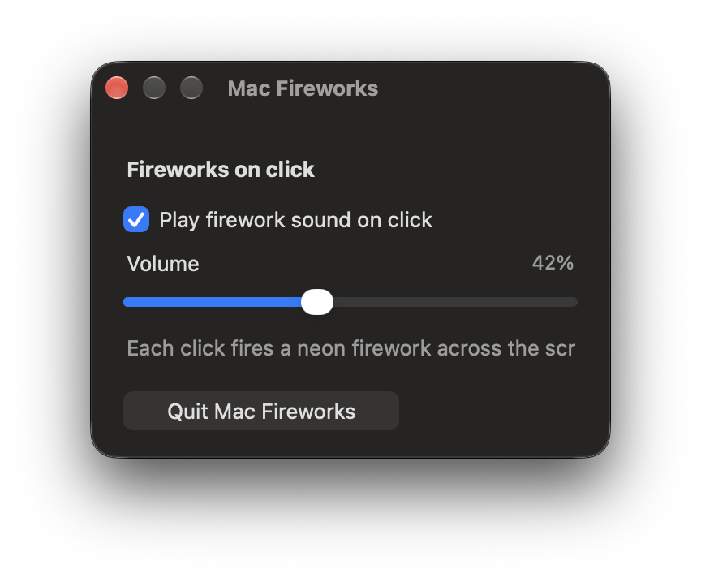

# Fireworks-cursor

  

## Settings

  

## Âm thanh

Các file trong `assets/` được cắt lại (mono, 44.1 kHz, 16-bit) cho vừa một lần click:

| File | Nguồn |
|---|---|
| `click.wav` | CC0 |
| `pop.wav` | Mixkit – “Bubble pop up alert notification” |
| `chime.wav` | Mixkit – “Relaxing bell chime” |
| `firework.wav` | Mixkit – “Clear firework explosions” |
| `boom.wav` | Mixkit – “Short explosion” |

Mixkit Free License: dùng được cho cả mục đích thương mại, không cần ghi công.
